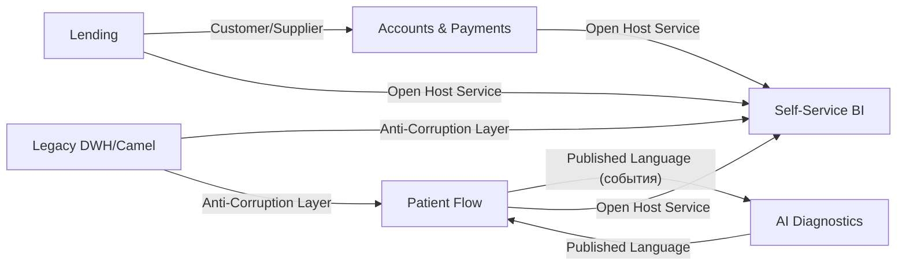

# Bounded Contexts - «Будущее 2.0»

Разбиение системы на домены по DDD. Каждый домен независимый bounded context
со своей моделью, командой (Data Product Owner) и публикуемыми событиями.

## Описание контекстов

| Bounded Context | Тип | Ответственность | Ключевые агрегаты |
|-----------------|-----|-----------------|-------------------|
| Patient Flow | Core | Регистрация, приёмы, маршрут пациента | `Patient`, `Encounter`, `Appointment` |
| AI Diagnostics | Core | Обработка снимков/данных ИИ, заключения | `Study`, `AIInference` |
| Lending | Core | Кредитные договоры, скоринг | `LoanApplication`, `LoanContract` |
| Accounts & Payments | Core | Счета, транзакции, переводы | `Account`, `Transaction` |
| Clinic Operations | Supporting | Управление клиниками, расписания | `Clinic`, `Schedule` |
| Staffing/HR | Supporting | Персонал, роли, смены | `Employee`, `Shift` |
| Inventory | Supporting | Оборудование, расходники | `InventoryItem` |
| IAM | Generic | Пользователи, роли, уровни доступа | `User`, `Role` |
| Billing | Generic | Выставление счетов за услуги | `Invoice` |
| Notifications | Generic | Уведомления клиентам/сотрудникам | `Notification` |
| Self-Service BI | Analytics | Дата-продукты, отчёты, конструктор | `DataProduct`, `Report` |

## Context Map

Паттерны:
- **Published Language** - общий язык событий.
- **Open Host Service** - домены публикуют дата-продукты для BI.
- **Anti-Corruption Layer** - изоляция от legacy DWH/Camel на миграции.
- **Customer/Supplier** - Lending зависит от Accounts.

